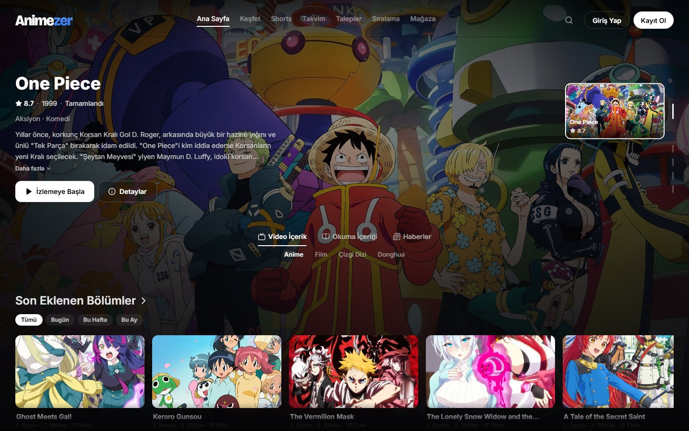
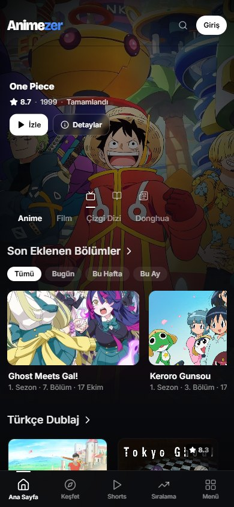

# Animezer

**A large anime streaming platform with apps for Android, Android TV and Windows.** Next.js 16, React 19, PostgreSQL, Redis.

## Overview

Animezer is a production web platform I designed, built and operate alone: the public site, a full administration panel, background workers, a set of client apps and the server it all runs on.

## Highlights

- **Web platform.** Server-rendered Next.js app with episode pages, a custom video player, schedules, rankings, short videos, news and a reading section. Fully responsive, with its own design system.
- **Administration panel.** Content management across several content types, users and roles, moderation (reports from ten sources in one queue, bans, DMCA, an audit log), comments, forum, announcements, requests, ads, settings with history, and a virtual-currency ledger.
- **Content pipeline.** Workers that collect metadata (TMDB, AniList), import episodes and track missing ones, with live progress streamed to the panel over Server-Sent Events.
- **Community and economy.** Accounts with 2FA and OAuth, XP and quests, daily rewards, a shop with animated cosmetics and timed collections, watch parties that persist while browsing, and in-browser multiplayer games.
- **Offline viewing.** An in-site download manager built on the Origin Private File System, with a service worker so downloaded episodes play without a connection.
- **Security work.** Two hardening rounds: XSS, CSRF, SSRF and race-condition fixes, rate limiting and hotlink protection, authorization checks on every admin endpoint.
- **Operations.** Self-managed Linux server behind Cloudflare, PM2, Nginx, Redis, fail2ban; zero-downtime builds; a server migration done in a day.

## Client apps

| App | Stack |
|---|---|
| Android | React Native (Expo 57), offline downloads, background playback, in-app updates |
| Android TV | React Native tvOS, D-pad focus navigation, voice search, Watch Next integration |
| Windows | Electron 44 shell with Discord Rich Presence |
| Discord bot | discord.js 14, TypeScript, PostgreSQL, 69 commands |

## Tech

Next.js 16 · React 19 · TypeScript · PostgreSQL · Redis · Tailwind CSS · Server-Sent Events · Service Workers / OPFS · React Native · Electron · Cloudflare · Nginx · PM2

> Source code is private. A walkthrough or code sample is available on request.

[Back to portfolio](../README.md)
