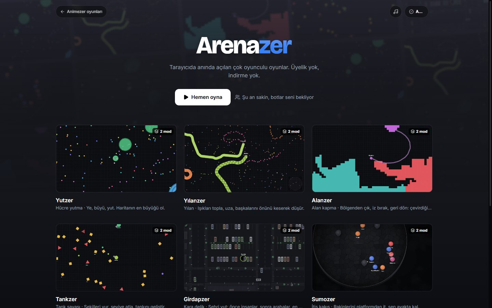

# Arenazer

**Eight real-time multiplayer .io games in the browser.** No sign-up, no download. TypeScript, React 19, Vite, Node.js WebSocket servers.

## Games

| Game | Genre |
|---|---|
| Yutzer | Cell eating (agar.io style) |
| Yılanzer | Snake (slither.io style) |
| Alanzer | Territory capture (paper.io style) |
| Tankzer | Tank shooter with upgrades (diep.io style) |
| Girdapzer | Black hole eating a city (hole.io style) |
| Sumozer | Push your rivals off the platform |
| Evrimzer | Evolution survival (mope.io style) |
| Avzer | Top-down battle royale (surviv.io style) |

## Highlights

- **Shared engine.** One room system for every game: public rooms per mode, private rooms with a five-letter code, bots that fill empty rooms, and a crash in one room never takes down another.
- **Authoritative server.** Game state is simulated on the server and streamed to every client over WebSocket, so clients cannot cheat on positions or scores.
- **Game modes.** Teams, short rounds, king of the hill, duos and more, configured per game from one place, with per-mode leaderboards.
- **Mobile first.** Custom touch joystick, haptics, full-screen play and a collapsible leaderboard; tested on real phones.
- **Platform integration.** Embedded in Animezer with signed game tickets for accounts, XP rewards and 300 unlockable character costumes.

## Tech

TypeScript · React 19 · Vite · Tailwind CSS 4 · Node.js · WebSocket · Canvas 2D

> Source code is private. A walkthrough or code sample is available on request.

[Back to portfolio](../README.md)
