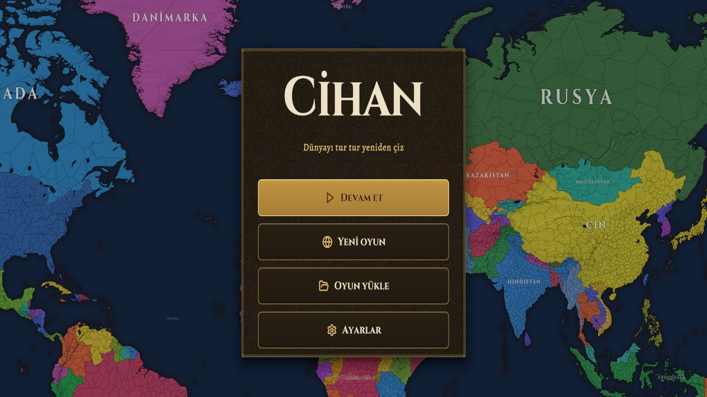
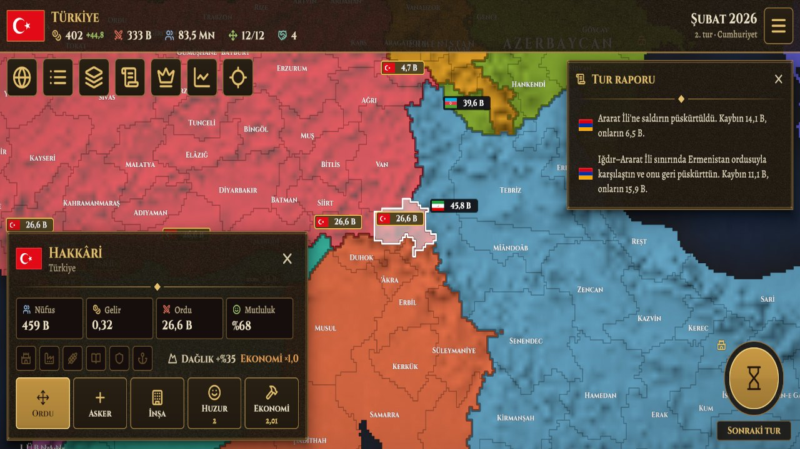
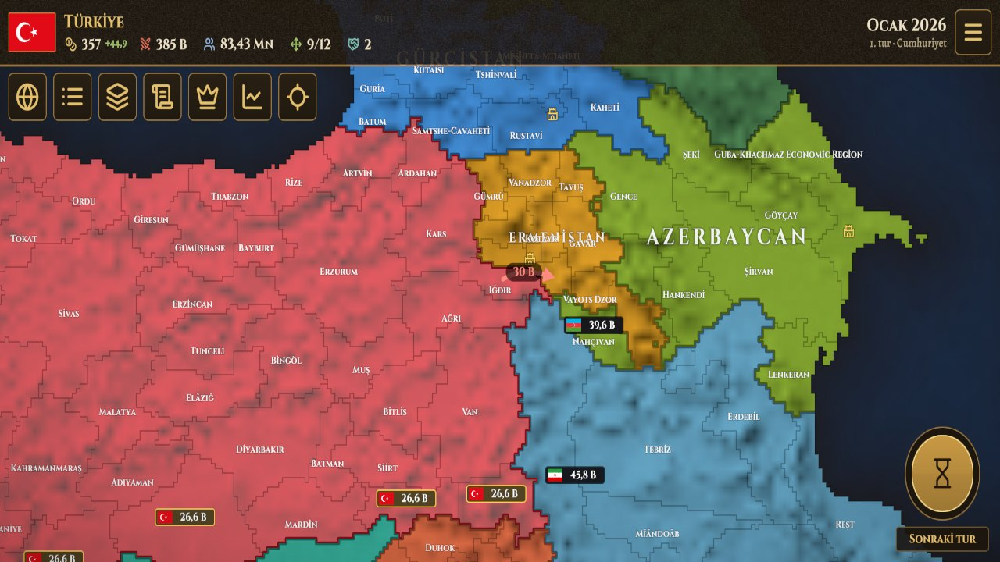

# Cihan

**Grand strategy game for mobile, in the spirit of Age of History.** Unity 6 (URP), C#, landscape.

## Overview

Pick a country and lead it turn by turn: grow the economy, raise armies, move them across a province map, sign treaties or go to war.

| | |
|---|---|
|  |  |

## Highlights

- **Generated map.** A map generator turns geographic data into hundreds of named provinces with borders, adjacency and labels that scale with zoom.
- **Turn-based simulation.** Population, income, army strength and happiness per province; armies with movement, combat and occupation; turn reports.
- **Diplomacy and events.** Relations, alliances and peace deals, plus random events with choices.
- **Mobile interface.** Touch pan and zoom, contextual province panels and a period-style visual theme.
- **Testing helpers.** Editor tools that drive the game from the command line and capture screens for review.

## Tech

Unity 6000.1 · URP · C# · procedural map generation · Unity CLI automation · Android

> Source code is private. A walkthrough or code sample is available on request.

[Back to portfolio](../README.md)
