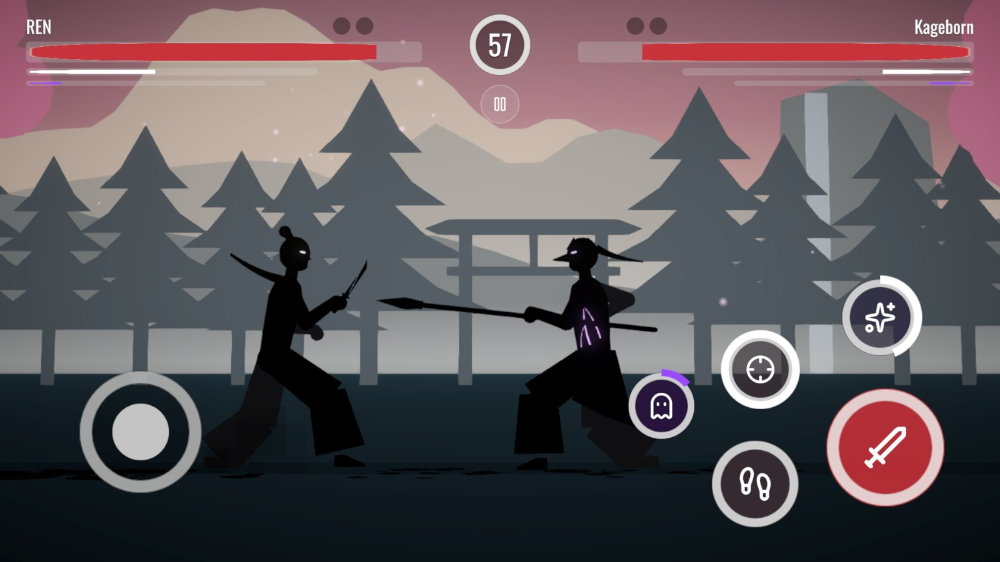
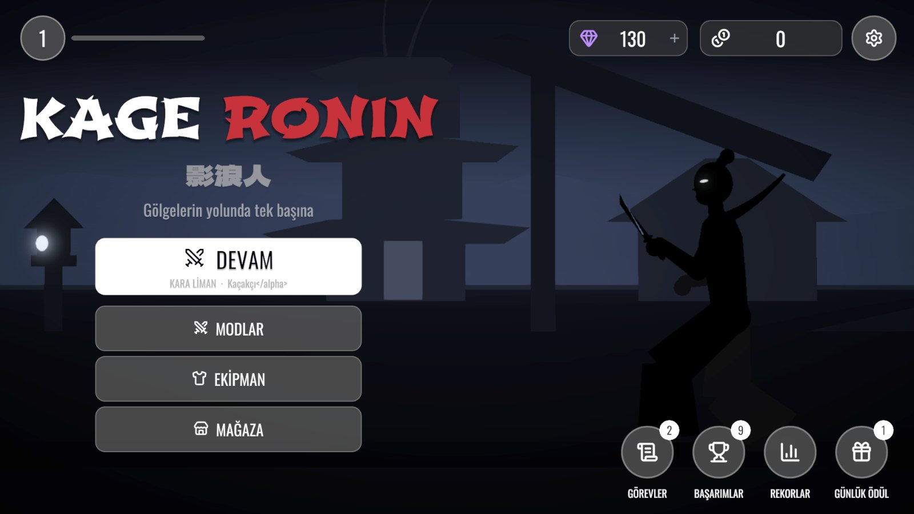
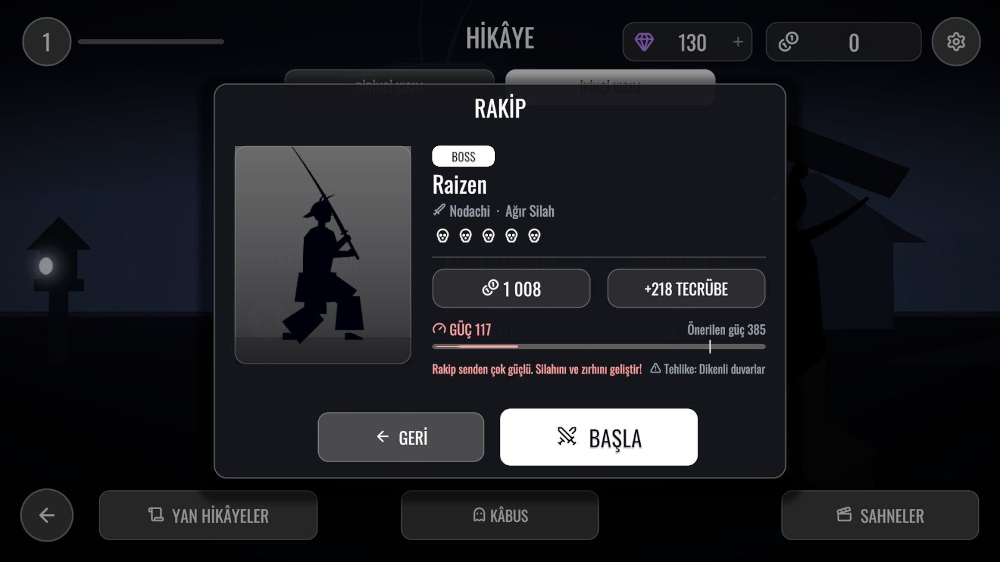
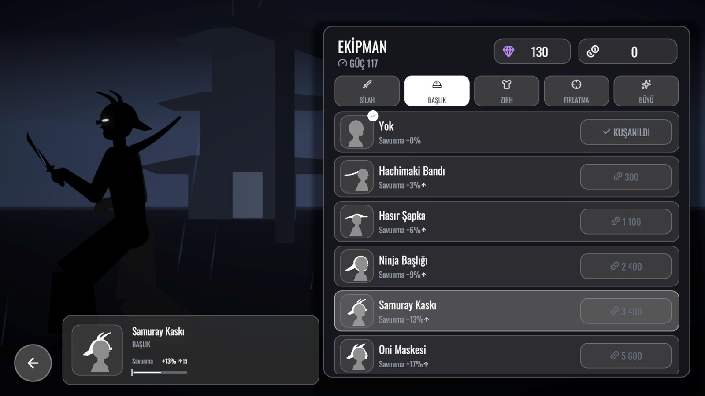
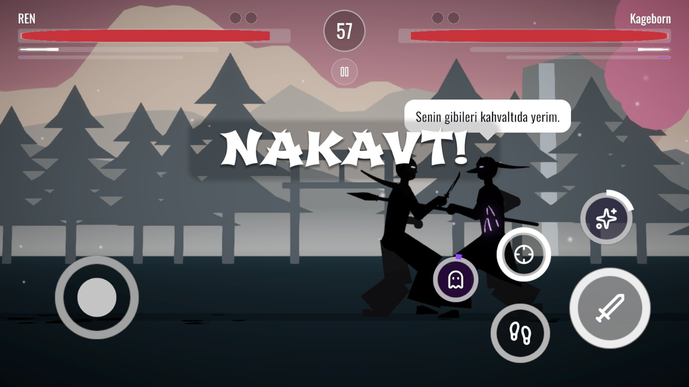

# Kage Ronin

**Silhouette fighting game for Android, in the spirit of Shadow Fight.** Unity 6 (URP), C#.

## Overview

A one-on-one sword fighting game with a full story campaign. You play Ren, a ronin carrying a shadow power, through two story parts, eight regions and 48 fights, each region closing with a boss who has a signature move of their own.

Almost nothing is authored in the editor: the interface, the arenas, the fighters and their animation are all built from code at runtime. That keeps the game small, easy to change and consistent across fourteen languages.

| | |
|---|---|
|  |  |
|  |  |

## Highlights

- **Procedural animation.** Each fighter is a 15-bone 2D rig. Poses are described as hand and foot targets plus a weapon angle and solved with two-bone IK; moves are keyframed in a few poses and expanded into anticipation, strike, follow-through and recovery on Hermite curves. Blending between states uses critically damped springs, so nothing snaps.
- **Nine weapon styles.** Sword, heavy, dual blades, staff, chain-sickle, war fan, fists, iai (draw-cut from the sheath) and spear, each with its own move set, combos and finishers.
- **Combat depth.** Dashes and backflips (double-tap the stick), running attacks, plunging attacks, counters after a block, parries, a 14-combo system, a shadow form, magic and thrown weapons, environmental hazards.
- **AI with personalities.** Opponents have tempers (aggressive, duellist, hit-and-run, keep-away, trickster); bosses use telegraphed signature moves that the AI itself knows how to dodge.
- **Data-driven balance.** A headless difficulty simulator plays every fight with a learning player model and reports the win curve, used to tune each opponent and the economy.
- **Story and presentation.** 16+ in-engine cutscenes with a small directing system, a dialogue layer, a replay of the last ten seconds and a photo mode.
- **Shipping features.** Fourteen languages (Latin, Cyrillic, Japanese, Korean and Chinese fonts), daily quests, achievements, a login calendar, weapon mastery, rewarded ads and in-app purchases behind build flags.
- **Accessibility.** Impact feedback uses hit-stop and camera work, never bright screen flashes.

## Tech

Unity 6000.1 · URP · C# · custom 2D rig and IK · runtime-built UGUI with TextMesh Pro · Unity CLI automation for builds and tests · Android (ARM64)

> Source code is private. A walkthrough or code sample is available on request.

[Back to portfolio](../README.md)
