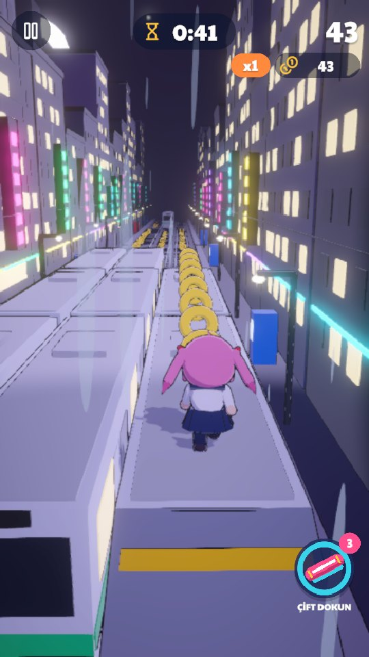
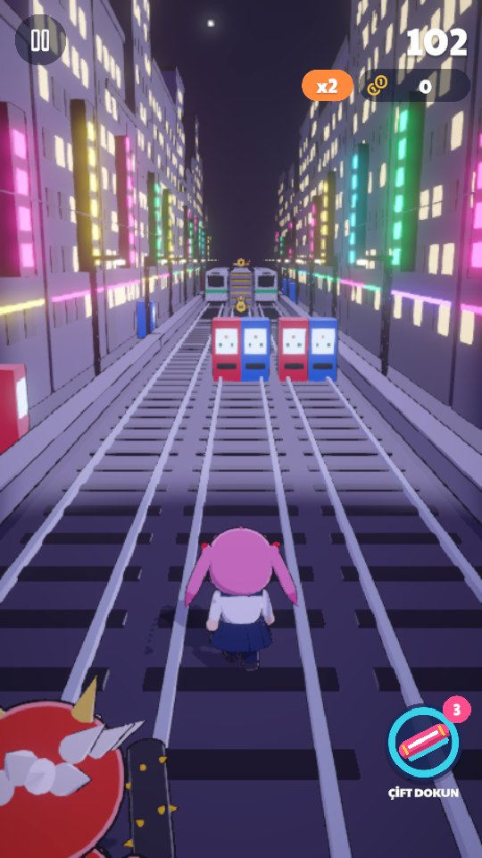
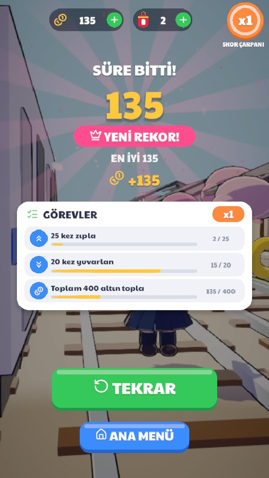

# Oni Rush

**Anime-styled endless runner for mobile, in the spirit of Subway Surfers.** Unity 6 (URP), C#, portrait.

| | | |
|---|---|---|
|  |  |  |

## Highlights

- **Ten playable characters and seven worlds**, each world with its own track pieces, obstacles and lighting.
- **Three game modes**, including a timed gold rush and a chase mode, with missions, records and results screens.
- **Run economy.** Coins, power-ups, a skateboard that saves you from one crash, charms and reward boxes.
- **Performance on phones.** GPU instancing for coins and repeated props, pooled track segments and a tight draw-call budget.

## Tech

Unity 6000.1 · URP · C# · object pooling · GPU instancing · Android

> Source code is private. A walkthrough or code sample is available on request.

[Back to portfolio](../README.md)
