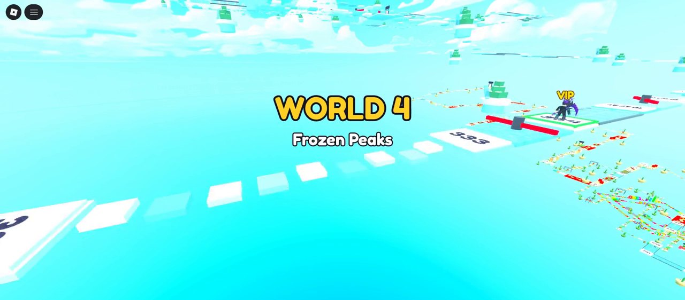
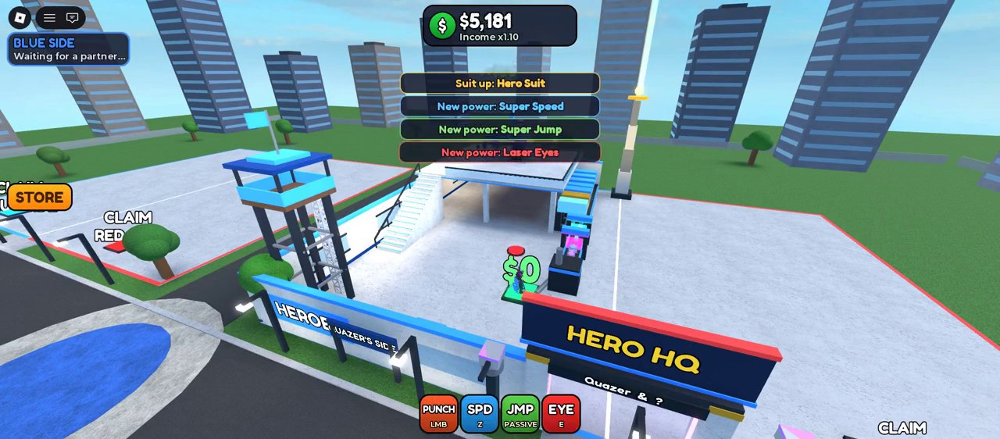
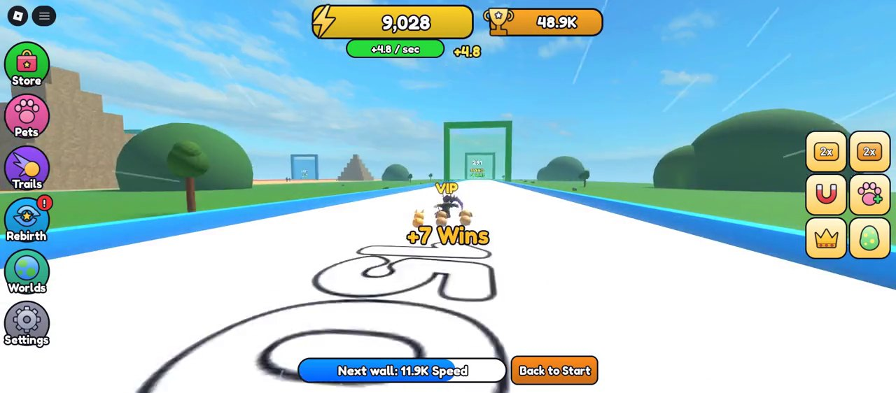

# Roblox games

Three games built in Roblox Studio with Luau, each with its own progression loop and monetization.

## Mega Fun Obby

An obstacle course with **1000 stages across 10 themed worlds**: 50 handcrafted stages and 950 generated by a stage generator that mixes and scales obstacle patterns by difficulty. Checkpoints, skips, trails and 14 game passes.

## 2 Player Superhero Tycoon

A two-player cooperative tycoon: build a hero headquarters, unlock powers (speed, super jump, laser eyes) and upgrade income. Map built with a reusable map kit, custom interface, game passes and developer products.

## +1 Speed Every Second

Speed grows every second; race down a track into walls of increasing strength, collect pets, rebirth for multipliers and climb leaderboards. Six game passes and six developer products.

## Tech

Roblox Studio · Luau · server-authoritative data with DataStores · MarketplaceService · procedural stage generation

> Source code is private. A walkthrough or code sample is available on request.

[Back to portfolio](../README.md)
